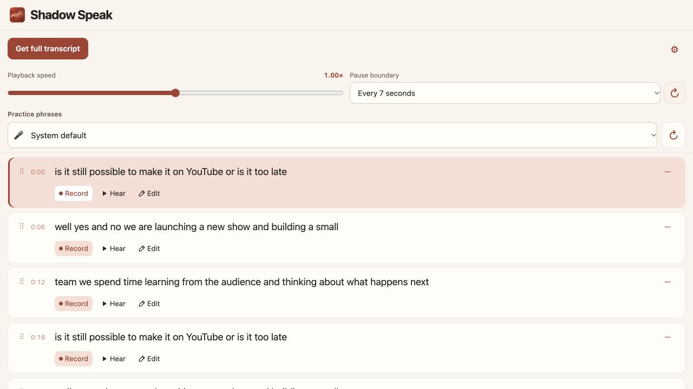

  

<h1 align="center">Shadow Speak</h1>

<strong>Stay on YouTube. Start speaking.</strong>

Found a video you want to learn from? Practice English right beside it. Listen to a phrase, record yourself, and hear it back without switching between tools or websites.

**[Get started](#get-started)** · **[How it works](#how-it-works)** · **[Feedback](#feedback)**

*Practice panel preview with sample transcript text.*

## Why Shadow Speak?

You find a podcast, interview, or vlog you want to learn from. Practicing often means pausing, rewinding, and finding the same sentence again. Shadow Speak brings those practice controls beside your video.

- **Stay with your video.** Open Shadow Speak on YouTube and practice on the same page, without moving between a transcript website, a recorder, and the video.
- **Spend more time speaking.** Click a phrase to play its video segment once and pause at its end.
- **Listen to your own voice.** Record your attempt and play it back, then listen to the original again at your own pace.
- **Come back tomorrow.** Saved transcripts appear when you return to the same video in the same Chrome profile. Reusing a saved transcript makes no new transcript API request.

## How it works

1. **Listen.** Click a phrase to hear the original video segment. Playback pauses at the phrase boundary.
2. **Repeat.** Click **Record**, allow microphone access if asked, and say the phrase. Recording stops after a short pause once you have spoken; you can also click **Stop**.
3. **Hear.** Click **Hear** to listen to your recording. Repeat the original or try another take whenever you want.

## Make it your practice

- **Choose your pace.** Adjust playback speed while practicing.
- **Choose your phrase length.** Use **By pause** for sentence endings and caption gaps, or **Every 7 seconds** for groups near a seven-second target. Choose a mode and click **↻** to apply it using the saved transcript.
- **Fix the words.** Edit a phrase when the transcript needs a correction.
- **Bring phrases together.** Drag adjacent cards together to merge them. Their video order stays the same; **Unfold** reverses the latest merge.
- **Keep the page focused.** Fold phrases you do not want to focus on. Folding hides their content and does not skip video playback.
- **Follow along.** The current phrase is highlighted as the video plays or when you seek to another point.

## Get started

**You will need desktop Chrome and your own [Supadata API key](https://dash.supadata.ai/).** This version uses Supadata to fetch new transcripts; requests may consume credits under your Supadata plan. Your key is remembered after the first setup.

### Install in Chrome

1. [Download the source ZIP](https://github.com/Lauren-fu/shadow-speak/archive/refs/heads/main.zip) and extract it, or clone this repository.
2. Open `chrome://extensions` and turn on **Developer mode**.
3. Click **Load unpacked** and select the extracted folder containing `manifest.json`.
4. Refresh YouTube. Open a video, then click **Shadow** below the video or the Shadow Speak icon in Chrome's toolbar.

### Start a session

Save your Supadata API key once, then click **Get full transcript**. Choose your microphone and start with any phrase. If the video already has a saved transcript, it appears automatically.

**Updating an existing installation?** Replace the files in the same folder Chrome already loads, reload the extension at `chrome://extensions`, and refresh YouTube. You do not need to uninstall it.

## Your data

- **Voice recordings stay local.** The extension does not upload your microphone audio. Recordings are kept in the current panel session and are cleared when it closes or you change videos or tabs.
- **Transcripts and changes stay in your Chrome profile.** Saved transcripts, text edits, merges, and fold choices can restore on future visits. They do not sync to other devices.
- **Your key is your own.** It is saved locally and used to authenticate requests to Supadata. No shared provider key is included in the extension.
- **New transcript requests go to Supadata.** The extension sends the YouTube video link, not your microphone recording. Saved transcripts can be reused and re-split without another provider request.

## FAQ

### Do I need to enter my API key for every video?

No. Save it once in the same Chrome profile. Use the settings button to change it later. Removing the extension or clearing its storage removes the saved key and transcripts.

### Does By pause detect the speaker's actual pauses?

It estimates phrase boundaries from sentence punctuation and caption timing; it does not analyze audio silence. Long passages are split into shorter practice segments. Cuts inside a caption block use estimated word times, so precision depends on the source captions.

### Can I keep my recordings for tomorrow?

Recordings currently last only for the panel session. Transcripts and compatible text edits, merges, and folds are saved separately. When a new split no longer matches earlier changes, the extension shows a warning rather than applying them to the wrong phrases.

### Does it work with every YouTube video?

Shadow Speak is designed for regular desktop YouTube watch pages. Shorts, live streams, embedded players, and mobile pages are not currently supported targets. Transcript availability and timing vary by video. Optional AI transcription fallback in settings can take longer and use additional Supadata credits.

### Does it score or correct my pronunciation?

No. You can listen to the original and your own recording to compare them yourself. This version does not provide automatic pronunciation scores or corrections.

## Feedback

Found a bug or have an idea? [Open an issue](https://github.com/Lauren-fu/shadow-speak/issues). Include your Chrome version, the YouTube link, and what you expected to happen.

---

[Development notes](docs/DEVELOPMENT.md) · [Release history](CHANGELOG.md)
